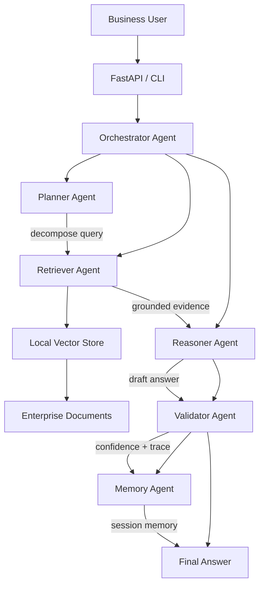

# Architecture and Agent Flow

The architecture diagram below is stored in the docs folder and can be opened directly in a browser or converted to PNG/JPG if needed.

- Source diagram: `docs/architecture-flow.svg`

The vector version is the source asset and is preferred for documentation because it scales cleanly while preserving clarity. It can also be exported to PNG/JPG using common tools such as browser print-to-PDF or image conversion utilities.
